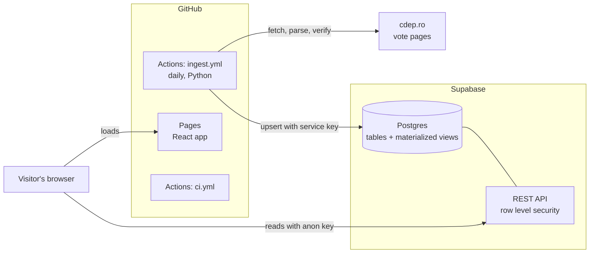

# Romanian Parliament Vote Tracker

How the Romanian Parliament votes, updated daily: every electronic vote in the
Chamber of Deputies and in joint sittings, with each member's ballot, party
cohesion over time, how often parties vote alike, and attendance per member.

Live site: <https://alex-malainic.github.io/rp-tracker/> (once GitHub Pages is
enabled, see [Going live](#going-live)).

## Architecture



| Part | Where it runs | What it does |
|---|---|---|
| `ingestion/` | GitHub Actions, once a day | Fetches the day's votes from cdep.ro, checks every vote's ballots against the official tally, upserts into Supabase |
| `supabase/` | Supabase (Postgres) | Tables, row level security, materialized views for the charts |
| `frontend/` | GitHub Pages | React app that reads from Supabase with the public anon key |
| `api/` | Nowhere yet | FastAPI service around the same ingestion code, reserved for phase two |

The data source, its formats and its many quirks are documented in
[docs/data-source.md](docs/data-source.md). The original project brief is in
[docs/brief.md](docs/brief.md).

## Trade-offs

- **No deployed backend.** GitHub Pages serves only static files, and free
  application hosts put idle services to sleep, which makes for a slow first
  visit. The browser reads straight from Supabase instead, so the site stays
  responsive at no cost. The price is that queries live in the frontend and
  access control lives entirely in Postgres policies.
- **Supabase rather than files in the repository.** The data is relational and
  grows by thousands of rows per sitting day. Postgres gives joins, upserts
  and aggregates; committing data files would bloat the history and turn the
  repository into a data store.
- **Materialized views rather than live aggregates.** Cohesion and similarity
  scan every ballot. They are recomputed once after each ingestion, so page
  loads never pay for them.
- **A daily cron rather than anything live.** Parliament sits a few days a
  week and results do not change after the sitting. The job re-reads the last
  three days on each run, which costs nothing because loads are idempotent and
  covers a failed run or a late correction.
- **HTML scraping rather than the XML feeds.** cdep.ro offers XML exports, but
  they omit member ids, the final-vote marker and the bill a vote belongs to.
  The parser therefore reads the HTML pages and fails loudly on anything it
  does not recognise; a failed run opens a GitHub issue.
- **FastAPI is written but not deployed.** It reuses the ingestion package
  unchanged, so phase two (AWS Lambda behind API Gateway, via Terraform) is a
  deployment task, not a rewrite.

## What the numbers mean

- **Carried / not carried** means more votes for than against. The source does
  not publish the official outcome, which for some votes depends on a
  qualified majority.
- **Group position** is the choice most of a group's voting members made.
- **Cohesion** is the share of a group's ballots that matched its position.
- **Attendance** is inferred. The source lists only members who were present,
  so a member is expected at every vote of their chamber between their first
  and last recorded ballot. Senators appear only in joint sittings.

## Local setup

Requirements: [uv](https://docs.astral.sh/uv/) and Node 22.

```bash
# Python: ingestion, API, tests
uv sync --all-extras
uv run pytest
uv run ruff check && uv run ruff format --check

# Fetch and verify a day without a database
uv run python -m ingestion --date 2026-11-10 --dry-run

# Load into Supabase
export SUPABASE_URL=https://<project>.supabase.co
export SUPABASE_SERVICE_KEY=<service role key>
uv run python -m ingestion --date 2026-11-10
uv run python -m ingestion --from 2024-12-01 --to 2026-11-15   # backfill

# API (optional)
ADMIN_TOKEN=<any secret> uv run uvicorn api.main:app --reload

# Frontend
cd frontend
cp .env.example .env.local   # fill in the project URL and anon key
npm install
npm run dev
```

## Going live

1. Create a Supabase project and run the two files in `supabase/migrations/`
   in order (SQL editor, or `supabase db push`).
2. In the GitHub repository settings add:
   - secrets `SUPABASE_URL` and `SUPABASE_SERVICE_KEY` (used by ingestion);
   - variables `SUPABASE_URL` and `SUPABASE_ANON_KEY` (built into the frontend;
     both are public by design).
3. Under Settings → Pages, set the source to "GitHub Actions".
4. Run the **Ingest** workflow manually with `date` and `to` set to backfill a
   range, then let the daily schedule take over.

Never commit the service role key: it bypasses row level security.

## Phase two

User accounts with Supabase Auth, following a party or a member, notifications
when they vote, and the FastAPI service deployed to AWS with Terraform and
GitHub OIDC.
